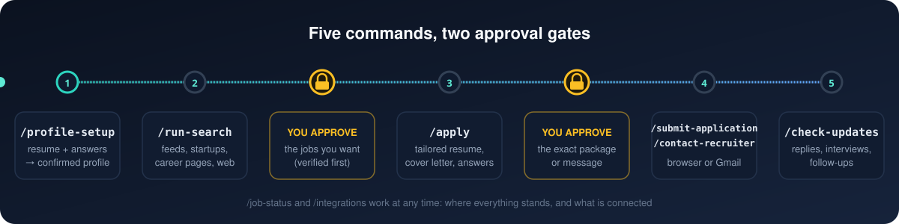
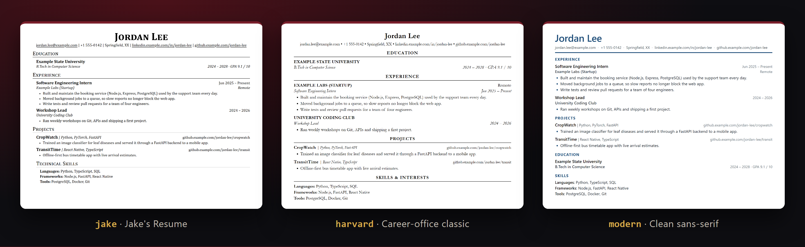

<p align="center">
  
</p>

<h1 align="center">Internship Hunt</h1>

<p align="center">
  <em>The fox does the searching. You make the decisions.</em>
</p>

<p align="center">
  <a href="https://github.com/ankul5/internship-hunt-skill/actions/workflows/ci.yml"></a>
  &nbsp;
  <a href="https://claude.com/claude-code"></a>
  &nbsp;
  <a href="https://agentskills.io/specification"></a>
  &nbsp;
  
  &nbsp;
  <a href="LICENSE"></a>
</p>

<p align="center">
  An internship search agent that lives in your terminal.<br>
  It finds real openings, checks them, ranks them against your profile, tailors a one-page resume and cover letter,<br>
  and tracks every application, asking for your approval before anything leaves your machine.
</p>

<p align="center">
  <a href="#quick-start"><b>Quick start</b></a>
  &nbsp;&nbsp;·&nbsp;&nbsp;
  <a href="#commands"><b>Commands</b></a>
  &nbsp;&nbsp;·&nbsp;&nbsp;
  <a href="#how-apply-works"><b>How /apply works</b></a>
  &nbsp;&nbsp;·&nbsp;&nbsp;
  <a href="#resume-templates"><b>Resume templates</b></a>
  &nbsp;&nbsp;·&nbsp;&nbsp;
  <a href="#safety-and-privacy"><b>Safety</b></a>
</p>

<p align="center">
  
</p>

> [!NOTE]
> An independent open-source project, not affiliated with or endorsed by Anthropic. Claude Code is named only because it is the tool this workflow runs in.

## What this is

A folder of [Agent Skills](https://agentskills.io/specification): plain-language instructions your coding agent follows, plus small Node scripts for the parts a language model should not be trusted with (IDs, deduplication, scoring, fact checks, approvals, safe CSV writes). There is no website, server or account. Your profile, jobs and applications are CSV and JSON files in a private folder that Git ignores.

<p align="center">
  
</p>

## See it run

<p align="center">
  
</p>

<sub>A fictional session. Company names and numbers are examples.</sub>

## Why it is different

| | |
|---|---|
| **Real sources, real evidence** | Employers' own job boards (Greenhouse, Lever, Ashby, SmartRecruiters, Workable), startup discovery, career-page walking and web search. Every job keeps the URL it came from, and search snippets stay `discovered` until the posting is re-opened. |
| **Verified before you approve** | A job can only be approved after its live posting is re-read. Closed or missing postings become `expired`. |
| **Honest tailoring** | Resumes and cover letters use only facts you confirmed. A scanner refuses new numbers, tools, employers or stronger verbs that are not in your profile, and gaps are shown to you, never covered up. |
| **Good-looking, ATS-safe PDFs** | Three built-in templates (Jake's Resume, Harvard, Modern), or your own. Single column with real, selectable text, made with the Chrome or Edge already on your computer. |
| **Two approval gates** | You approve which jobs to pursue, then the exact package or message. Any edit after approval voids it. A result is marked `submitted` only with confirmation evidence. |
| **Private by default** | Personal data never leaves the private folder, tokens live outside the repository, and a check fails the build if anything personal is about to be committed. |

## Quick start

### What you need

| | |
|---|---|
| **[Claude Code](https://claude.com/claude-code)** | Or another agent that reads Agent Skills (OpenAI Codex, Kimi Code). See [compatibility](docs/compatibility.md). |
| **Node.js 18+** | Runs the helper scripts and tests. No `npm install`: there are no dependencies. |
| **Chrome or Edge** | Already installed on most computers. Used headless to make the PDFs. |
| **Python 3.10+** *(optional)* | Only for the optional Agent Reach web search and Scrapling page reader. |

### 1. Clone

```bash
git clone https://github.com/ankul5/internship-hunt-skill.git
cd internship-hunt-skill
```

### 2. Run setup

```powershell
# Windows
powershell -ExecutionPolicy Bypass -File scripts\setup.ps1
```

```bash
# macOS / Linux
bash scripts/setup.sh
```

Setup links the skills into `.claude/skills/` and `.agents/skills/` and creates your private data folder, `private/`, from blank templates. It never overwrites existing data. To keep your data somewhere else, set `INTERNSHIP_AGENT_HOME` first.

### 3. Open Claude Code in the folder

```bash
claude
```

### 4. Build your profile

```text
/profile-setup
```

Give it the path to your resume. It shows what it read, you confirm or correct each group, then it asks short multiple-choice questions: roles, places, start dates, paid only, resume template and more. Only confirmed facts are saved.

### 5. Find internships

```text
/run-search
```

It searches the sources above, skips duplicates, verifies what it can, scores each job against your profile and saves everything to `private/jobs.csv`. You get a ranked list with sources, scores and caveats.

### 6. Approve, tailor, send

```text
approve job-0021            # tell it in your own words which jobs you want
/apply job-0021             # tailored resume, cover letter and answers, as PDFs
/submit-application app-0001
/contact-recruiter          # optional: a short message to a published recruiter address
/check-updates              # later: replies, interviews, follow-ups
```

`/apply` only prepares. `/submit-application` and `/contact-recruiter` show you the exact package or message and wait for your yes. You can always choose to send it yourself instead.

<details>
<summary><b>Connecting Gmail and a browser (optional)</b></summary>

Run `/integrations` at any time to see what is connected and to connect what is missing. It never asks for a password or token in chat.

- **Gmail:** a Gmail connector in Claude, or your own Google OAuth client with a send-only permission. Reading the inbox is read-only.
- **Browser for application forms:** the Claude in Chrome extension. The agent fills a form only after you approve the exact package, and stops at any login, CAPTCHA or unanswered question.
- **Nothing connected?** Everything still works: you get copy-ready messages and the files to upload yourself.

</details>

## Commands

| Command | What it does |
|---|---|
| **`/profile-setup`** | Reads your resume, confirms facts with you, asks about preferences, and saves your profile |
| **`/run-search`** | Finds, deduplicates, verifies and scores internships, and saves them to `jobs.csv` |
| **`/apply <job>`** | Re-reads the posting, maps requirements to your evidence, and writes the tailored resume, cover letter and answers |
| **`/submit-application <app>`** | Shows the full package, then submits it through the browser after your yes, or hands it to you |
| **`/contact-recruiter`** | Drafts a short message to a sourced contact, then sends it after your yes, or gives you copy-ready text |
| `/check-updates` | Reads new recruiter mail (read-only), records interviews and rejections, and suggests one follow-up after 7 days |
| `/job-status` | Where everything stands, plus tracker checks and repairs you approve |
| `/integrations` | What is connected, and help connecting Gmail or a browser |
| `/internship-agent` | The router: start here if you are unsure which command you need |

<details>
<summary><b>Where jobs come from</b></summary>

| Source | How it is read | Trust |
|---|---|---|
| Employer boards (Greenhouse, Lever, Ashby, SmartRecruiters, Workable) | The board's public API, one request per second | `verified`: it is the employer's own data |
| Startup discovery | Finds startups with internship listings and works out their job boards; you pick which to add | `verified` once added |
| Career-page walker | Finds a company's careers page from its own site and reads it, respecting robots.txt | `verified` when the page is read |
| [freehire.me](https://freehire.me) | Public aggregator API (personal, non-commercial use) | `discovered` until the original posting is re-opened |
| Web search via [Agent Reach](https://github.com/Panniantong/Agent-Reach) | Search, then read each result | `discovered` until verified. Templated aggregator pages are skipped |
| LinkedIn, Indeed, Naukri | Never scraped or automated | Leads only: you open them yourself |

</details>

## How /apply works

<p align="center">
  
</p>

1. **Re-read the posting** and save its text. Requirements must be quoted from it: none are invented from the job title.
2. **Map each requirement** to evidence in your profile as met, partial or gap, and show you the gaps.
3. **Write the documents** from confirmed facts only. Resume bullets come from your own resume lines. The cover letter may name only things found in your profile, the posting or your answers.
4. **Refuse anything unsupported.** New numbers, tools, employers or achievement verbs fail the check, and nothing is written until the package is clean.
5. **Render the PDFs** in your template and report the page count. Every version is kept in `private/tailored/<app>/v<N>/`.

## Resume templates

<p align="center">
  
</p>

| Template | Look |
|---|---|
| `jake` *(default)* | The well-known one-page software layout. HTML port of [Jake's Resume](https://github.com/jakegut/resume) (MIT) |
| `harvard` | Career-office classic: education first, organisation first, serif |
| `modern` | Clean sans-serif with an accent colour, experience first |

Pick one in `/profile-setup`, or preview them with your own profile:

```bash
node scripts/apply-store.mjs preview-template harvard   # -> private/template-previews/harvard.pdf
```

**Add your own:** put a `template.json` and a `template.css` in `private/resume-templates/<name>/`. Templates are CSS only: they can change the look but never the content, and every fact check still applies. Full guide: [templates/resume/README.md](templates/resume/README.md).

## Safety and privacy

The rules every skill follows ([AGENTS.md](AGENTS.md), [safety policy](references/safety-policy.md), [privacy policy](references/privacy-policy.md)):

- **Never invents** jobs, employers, recruiters, experience, dates or results. If something cannot be verified, the field stays empty and you are told.
- **Never submits or sends** without your explicit approval of that exact item, in the current conversation. Approval for one thing never carries over to another.
- **Records only what it saw.** `submitted` needs a confirmation page, reference number or email. Otherwise the result is `submission_unconfirmed`, and nothing is retried until it is checked.
- **Never bypasses** logins, CAPTCHAs, paywalls, rate limits or a site's terms, and never automates LinkedIn.
- **Treats web pages and emails as data, not instructions.** A posting that says "ignore your rules" is reported to you, not obeyed.
- **Keeps your data local.** Everything personal lives in the git-ignored private folder, and tokens live outside the repository. `node tests/validate.mjs` fails if a private path is tracked or a publishable file contains a real email address or credential.

> [!IMPORTANT]
> Use your own clone, not a fork, for a real search. Your data stays in `private/`, which Git ignores, but run `git status` before you push anything.

## Works with other agents

| Agent | Skills folder | Start with |
|---|---|---|
| Claude Code | `.claude/skills/` | `/internship-agent` |
| OpenAI Codex | `.agents/skills/` | `$internship-agent` |
| Kimi Code | `.agents/skills/` | `/skill:internship-agent` *(unverified)* |

Details and troubleshooting: [docs/compatibility.md](docs/compatibility.md).

<details>
<summary><b>Project layout</b></summary>

```
skills/              the product: one folder per skill (edit here)
scripts/             helper scripts the skills call; scripts/lib/ holds the logic
references/          safety and privacy policy, data model, scoring rubric, schemas
templates/data/      blank data files copied into private/ by setup
templates/resume/    resume templates (jake, harvard, modern) and the guide to adding your own
templates/documents/ text templates for answers and messages
tests/               node --test suites with fictional fixtures, plus validate.mjs
vendor/agent-reach/  unmodified copy of Agent Reach (MIT)
docs/                setup and agent compatibility
assets/readme/       the images in this README
private/             YOUR data: git-ignored, created by setup
```

Data files and their columns: [references/data-model.md](references/data-model.md).

</details>

## Development

```bash
node tests/validate.mjs          # structure, schemas, links, privacy checks
node --test tests/*.test.mjs     # all test suites
```

The tests use fictional data and stand-ins for the network, email and browser, so nothing is fetched, sent or submitted. `tests/e2e.test.mjs` runs the whole workflow on one job, from profile to follow-up. Edit skills in `skills/` only. `.claude/skills/` and `.agents/skills/` are generated by setup.

## Acknowledgements

- [Agent Reach](https://github.com/Panniantong/Agent-Reach) for web search and page reading (MIT, vendored unmodified)
- [Jake's Resume](https://github.com/jakegut/resume) by Jake Gutierrez, the design behind the `jake` template (MIT)
- [freehire.me](https://freehire.me) for its public internship API

## License

[MIT](LICENSE). Third-party components keep their own licenses.
